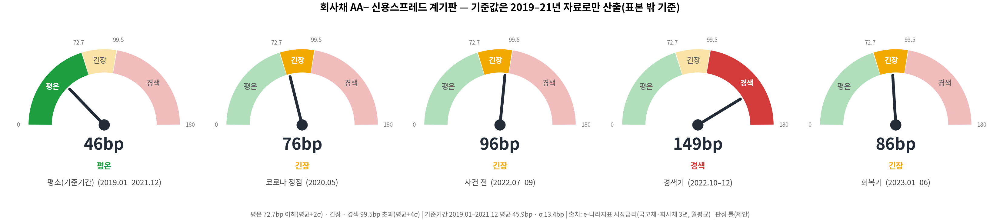
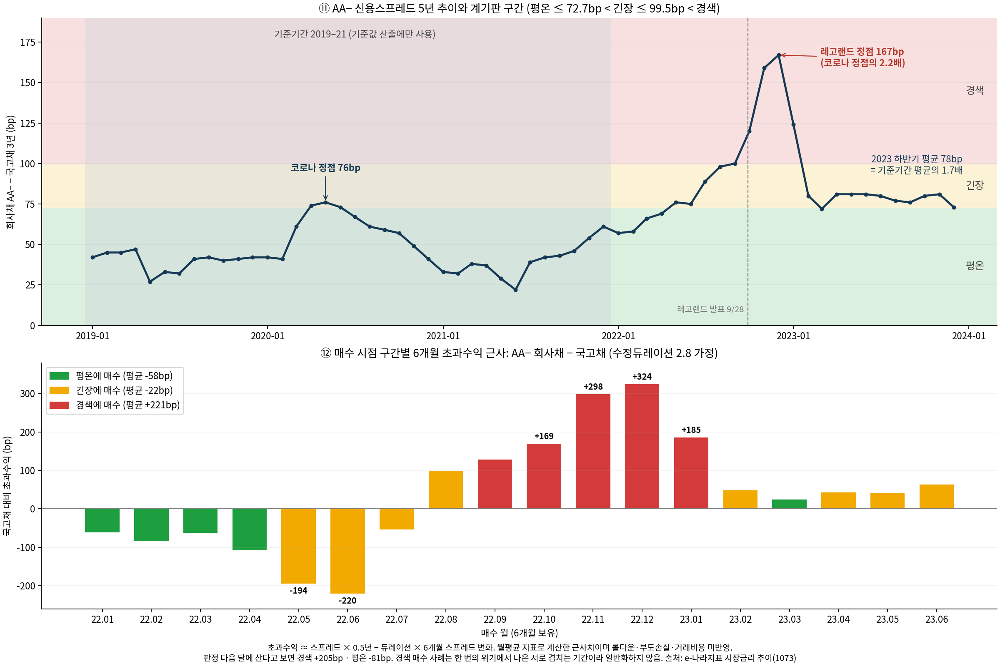
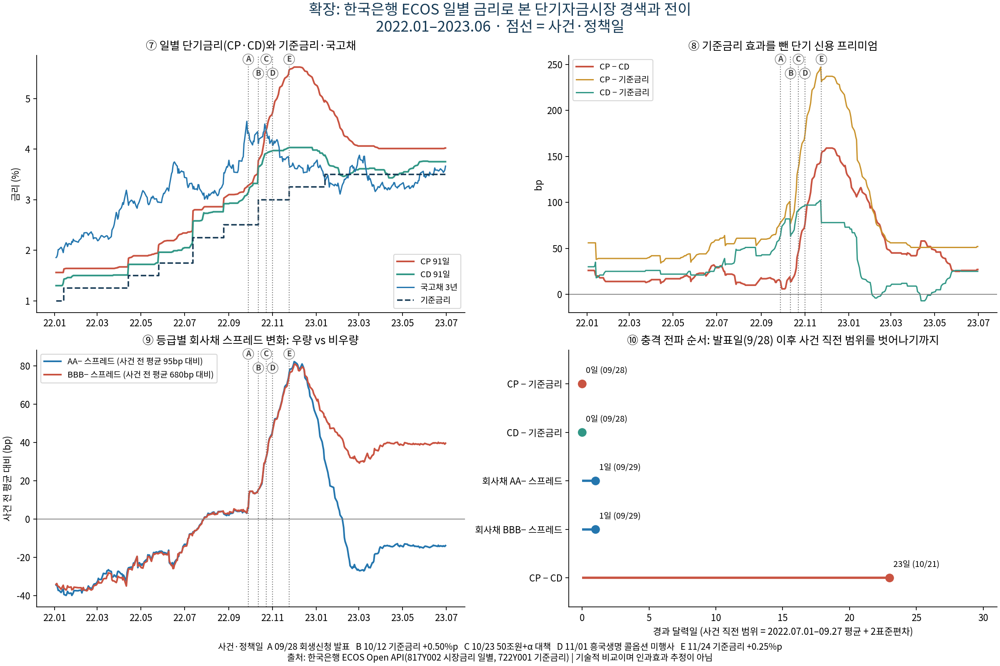
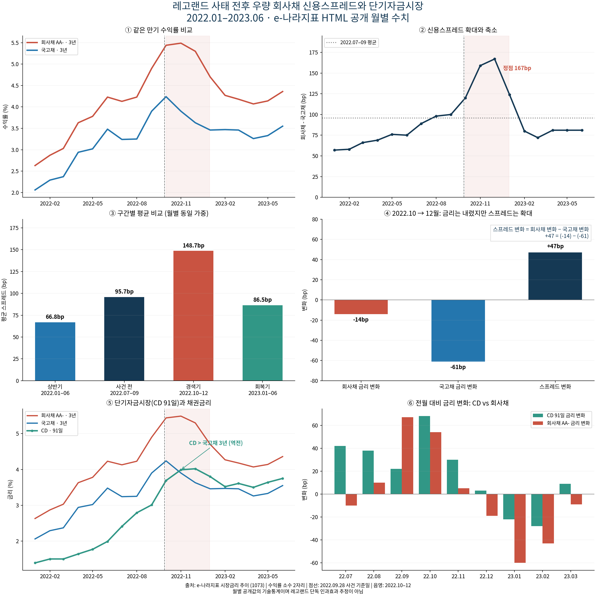

# 레고랜드 사태와 신용스프레드 계기판 — 평소 범위를 정하고, 벗어나면 경보

> 2022년 레고랜드 회생신청 이후 우량 회사채(AA−)의 신용스프레드는 코로나 충격 때의 **2.2배**까지 벌어졌습니다.
> 공공 웹페이지 크롤링과 한국은행 API로 금리를 모아 수치로 확인하고, 과거 평소 범위(평균 + 2σ / 4σ)로 **평온·긴장·경색 3단계 계기판**을 만들었습니다.

| 항목 | 내용 |
|---|---|
| 형태 | KB Bridge 부트캠프 Module 03 미니프로젝트 · 팀 프로젝트 (Money Catcher 조) |
| 사용 기술 | Python (requests, BeautifulSoup, Pandas, Matplotlib) · 한국은행 ECOS API · SQLite · Google Colab |
| 데이터 | e-나라지표 월별 금리 60개월 (2019–2023) + ECOS 일별 금리 6종 370영업일 (2022.01–2023.06) |
| 핵심 결과 | AA− 스프레드 96bp → 149bp (+55%), 정점 167bp · 원본 해시 검증 후 결과 파일 18개 바이트 단위 재현 |

**내 역할** : 분석·계기판 설계 및 품질 관리 — 보조 데이터 소스 기술 검토, 크롤링 목적 공유, 스프레드 계기판 시각화 제작, 제출 전 자체 품질 검증까지 데이터 수집 전략부터 최종 산출물 점검을 담당. BeautifulSoup·API 수집 코드를 Colab에서 실행해 검증



---

## 01. 프로젝트 배경

2022년 9월 28일, 지자체가 보증한 레고랜드 채무가 흔들리자 우량 기업의 자금 조달까지 막혔습니다. 신용 위험이 한 곳에서 시장 전체로 번지는 과정을 공공 데이터로 확인할 수 있는 사례입니다.

**신용스프레드**(회사채 금리 − 국고채 금리)는 기업이 위험 때문에 더 내는 이자입니다. 기업 재무팀은 이 값으로 자금 조달 시점을 판단하고, 채권 투자자는 매수 시점을 판단합니다.

## 02. 업무 문제

| 질문 | 내용 |
|---|---|
| Q1 | 사태 전후 AA− 스프레드는 평소·코로나 충격과 비교해 얼마나 벌어졌고, 언제 회복됐나? |
| Q2 | 시장금리가 내려갈 때 스프레드도 함께 줄었나? |
| Q3 | 단기자금시장(CD·CP)은 회사채 시장보다 언제, 얼마나, 얼마나 오래 흔들렸나? |
| Q4 | 과거 기준으로 스프레드를 평온·긴장·경색으로 나누면 판단 보조지표로 쓸 수 있나? |

## 03. 데이터 설명

| 출처 | 수집 방식 | 내용 | 주기·기간 |
|---|---|---|---|
| e-나라지표 시장금리 추이 | requests + BeautifulSoup 크롤링 | 국고채 3년, 회사채 3년(AA−), CD 91일 | 월평균, 2019.01–2023.12 |
| 한국은행 ECOS Open API | requests → JSON | 국고채·회사채(AA−·BBB−)·CD·CP·기준금리 | 일별, 2022.01–2023.06 |

- 크롤링 대상 수치는 표가 아니라 본문 텍스트 안에 있어, BeautifulSoup으로 해당 요소를 찾고 **조건에 맞는 요소가 정확히 1개인지 확인한 뒤** 정규식으로 값을 추출했습니다.
- robots.txt 판정을 기록하고, 대상 페이지는 1회만 요청했습니다. 이후 분석은 저장 원본을 재사용합니다.
- API 키는 코드·파일·오류 메시지 어디에도 저장하지 않습니다.

## 04. 데이터 전처리

원칙은 "**고치지 않고, 확인하고, 문제가 있으면 멈춘다**"입니다.

| 점검 | 결과 | 처리 원칙 |
|---|---|---|
| 원본 무결성 | HTML 1개, JSON 6개 SHA256 해시 일치 | 해시가 다르면 실행 중단 |
| 중복·결측·누락 월 | 0 / 0 / 0 | 하나라도 있으면 임의 값 없이 중단 |
| 이상값 | 제거·보간하지 않음 | 위기의 급등 자체가 분석 대상 |
| 월별 값의 성격 | 일별 값과 대조해 월평균임을 판별 (차이 최대 0.01%p) | 날짜 단위 판단은 일별 자료로 |
| 연도 표기 | `'22.10월` → 2022-10 | 1월과 10월이 섞이지 않게 두 자리 월로 저장 |

## 05. SQL 분석

정제한 표 12개를 SQLite DB(`db/legoland.sqlite`)에 저장했고, 무결성 검사(`integrity_check`)와 CSV·DB 값 일치를 확인했습니다.

```sql
-- 구간별 평균 스프레드
SELECT period, ROUND(AVG(spread_bp), 1) AS avg_spread_bp, COUNT(*) AS months
FROM analysis_monthly
GROUP BY period;
```

| 구간 | 평균 스프레드 | 개월 수 |
|---|---:|---:|
| 2022 상반기 | 66.8bp | 6 |
| 사건 전 (2022.07–09) | 95.7bp | 3 |
| **경색기 (2022.10–12)** | **148.7bp** | 3 |
| 회복기 (2023.01–06) | 86.5bp | 6 |

```sql
-- 계기판 구간별: 그 달에 AA− 회사채를 사서 6개월 보유했을 때 국고채 대비 초과수익 근사
SELECT zone, COUNT(excess_6m_bp) AS n, ROUND(AVG(excess_6m_bp), 1) AS avg_excess_bp
FROM gauge_zones_monthly
GROUP BY zone;
```

| 계기판 구간 | 표본 | 6개월 초과수익 근사 |
|---|---:|---:|
| 평온 | 5 | −58.0bp |
| 긴장 | 8 | −21.7bp |
| 경색 | 5 | +221.0bp |

## 06. Python 분석

**계기판 기준값** — 분석 기간과 겹치지 않는 2019–21년 자료로만 정했습니다.

```python
def gauge_thresholds(df, k_calm=GAUGE_CALM_K, k_stress=GAUGE_STRESS_K):
    base = df[df.date < BASE_END].spread_bp          # 2019.01–2021.12 = 평소 기준기간
    mu, sd = base.mean(), base.std()
    return mu + k_calm * sd, mu + k_stress * sd      # 평온 상한(2σ), 경색 하한(4σ)

def gauge_zone(v, calm, stress):
    return 0 if v <= calm else 2 if v > stress else 1   # 0 평온 · 1 긴장 · 2 경색
```

- 평온 ≤ 72.7bp (평균 + 2σ), 경색 > 99.5bp (평균 + 4σ)
- **복귀 판정은 5영업일 연속 기준** — 하루짜리 흔들림을 회복으로 세지 않기 위해서입니다.
- **민감도 검증** — 경색 기준을 3σ·4σ·5σ로 바꾸고, 판정 다음 달에 산다고 다시 계산해도 결론의 방향이 같은지 확인했습니다.

전체 코드: [`source/legoland_analysis.py`](source/legoland_analysis.py) (한 번에 실행) · [`source/legoland_colab.ipynb`](source/legoland_colab.ipynb) (실행 결과 저장)

## 07. 시각화

| 5년 스프레드 추이와 계기판 구간 | ECOS 일별 대시보드 |
|---|---|
|  |  |

| 월별 대시보드 (금리·스프레드·구간 비교) |
|---|
|  |

전체 분석 보고서: [`output/REPORT.md`](output/REPORT.md) (HTML판은 다운로드 후 브라우저로 열기)

## 08. 주요 인사이트

| 지표 | 사건 전 | 경색기 | 정점 |
|---|---:|---:|---|
| AA− 스프레드 (월별) | 96bp | 149bp (+53bp) | 167bp (2022.12) = 코로나 정점의 2.2배 |
| CP − CD (일별, 단기 신용 불안) | 17bp | 102bp (+85bp) | 159bp (2022.12.01) |

1. **추세가 아니라 급변이었다.** 사건 전 스프레드는 하루 평균 +0.32bp씩 오르고 있었는데, 발표 다음 날 하루에 +7.1bp가 올랐습니다. 사건 전 일간 변화 분포의 약 9표준편차에 해당합니다.
2. **금리가 내려도 스프레드는 벌어졌다.** 2022년 10–12월 회사채 금리는 14bp 내렸지만 국고채가 61bp 내려 스프레드는 47bp 커졌습니다. 금리만 보면 안정기로 착각할 수 있습니다.
3. **단기자금시장은 늦게, 더 크고 길게 흔들렸다.** CP − CD의 복귀는 2023년 5월 24일로 회사채(1월 30일)보다 4개월 가까이 늦었습니다.
4. **완전히 회복되지 않았다.** 2023년 하반기 스프레드는 평소(2019–21년 평균 46bp)의 1.7배인 78bp였습니다.
5. **금액으로 보면** — 스프레드 확대분 53bp를 1,000억 원 조달에 적용하면 연 약 5.3억 원의 이자가 더 듭니다.

## 09. 생산·제조 업무 활용 방안

이 프로젝트의 계기판은 구조적으로 제조 현장의 **SPC 관리도**와 같습니다.

| 이 프로젝트 | 생산·제조 현장 적용 |
|---|---|
| 평소 기간(2019–21)으로 평균 + 2σ / 4σ 기준선 설정 | **관리도 관리한계선**: 안정 구간 데이터로 중심선과 관리한계를 정하고, 새 데이터가 벗어나면 이상 신호 |
| 기준 산출 기간과 검증 기간을 겹치지 않게 분리 | 관리한계를 정한 데이터로 다시 판정하면 이상을 못 잡음 → **기준 데이터와 감시 데이터 분리** |
| 평온·긴장·경색 3단계 | 정상·주의·조치 단계별 대응 기준 (예: 주의는 점검 강화, 조치는 라인 정지·원인 분석) |
| 5영업일 연속이어야 복귀 인정 | 한 번 정상값이 나왔다고 조치를 해제하지 않는 **연속 확인 규칙** |
| 원본 SHA256 해시 검증, 불일치 시 중단 | 측정·검사 기록의 위변조·누락 방지 (데이터 무결성, 감사 추적) |
| 결측·중복이 있으면 임의 값 없이 멈춤 | 측정 누락을 추정값으로 채우지 않는 품질 기록 원칙 |
| 3σ·4σ·5σ 민감도 검증 | 관리한계 설정 기준을 바꿔도 판정이 크게 달라지지 않는지 확인 |
| 결과 파일 18개 바이트 단위 재현 | 같은 입력이면 같은 결과가 나오는지 검증하는 **공정·시험 재현성** 확인 |

**연결되는 경험:** 이 프로젝트에서 품질 관리 전반을 맡아 제출 전 산출물을 점검했습니다. 공공 하수처리시설에서 수질 분석값이 평소 범위를 벗어날 때 먼저 측정 과정을 확인했던 경험과 같은 방식입니다.

## 10. 한계 및 개선 방향

- **인과관계가 아닙니다.** 같은 시기에 기준금리 인상, 흥국생명 콜옵션 미행사, 글로벌 긴축이 겹쳐 레고랜드만의 효과를 분리하지 않았습니다.
- 계기판은 큰 위기가 한 번뿐인 5년 자료로 만든 기준이라, 금리 환경이 크게 바뀌면 기준값을 다시 계산해야 합니다.
- 6개월 초과수익은 월평균 지수로 계산한 근사치이며, 경색 구간 5회는 한 위기 안의 겹치는 기간이라 매수 신호로 단정하지 않습니다.
- 일별 계기판은 발표 전날 이미 경색에 들어갔습니다. 계기판은 수준을 판정할 뿐 원인을 구분하지 못합니다.

---

### 실행 방법

```powershell
python -m pip install -r requirements.txt
python source/legoland_analysis.py --offline   # 저장 원본으로 전체 재현 (인터넷·API 키 불필요)
```

원본 해시를 확인한 뒤 `data/`, `db/`, `output/`을 다시 만듭니다. 재수집 방법, 컬럼·구간 정의, 변경 이력은 [`docs/제출용_상세README.md`](docs/제출용_상세README.md)에 있습니다.

### 폴더 구조

```
07_레고랜드_신용스프레드_계기판/
├─ README.md
├─ source/        # 수집 → 전처리 → 분석 → 저장 → 시각화 → 보고서 (.py / Colab 노트북)
├─ data/          # raw(크롤링 HTML·ECOS JSON·해시 기록), 정제 CSV
├─ db/            # legoland.sqlite (표 12개)
├─ output/        # 보고서, 계기판·대시보드 그래프, 결과 표, 품질 검사 기록
├─ presentation/  # 발표자료 PPT (18장)
└─ docs/          # 제출용 상세 README
```
